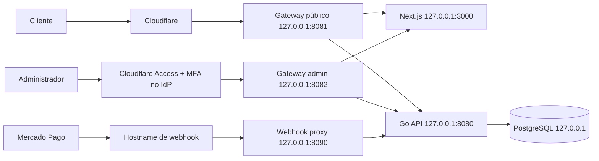

# Isolamento administrativo Zero Trust

## Diagnóstico da superfície anterior

Antes desta etapa, uma única aplicação Next.js servia loja, área do cliente e `/admin`; uma única API Go em `:8080` registrava rotas públicas, de cliente, administrativas e webhook. A autorização interna já existia (sessão administrativa, RBAC e CSRF), mas a rede não impedia que um visitante alcançasse a tela de login ou tentasse diretamente `/api/v1/admin/*`. O PostgreSQL também era publicado pelo Compose em todas as interfaces do host.

Os cookies administrativo e de cliente já são distintos e host-only (nenhum atributo `Domain`). O cookie administrativo é HTTP-only, SameSite=Strict e Secure em produção; o cookie do cliente é HTTP-only, SameSite=Lax e Secure em produção. O webhook já possui um proxy dedicado que aceita somente `POST /api/v1/webhooks/mercado-pago`, remove cookies/autorização e limita requisições.

## Decisão

A implementação adota três ingressos independentes e fail-closed:

- O gateway público bloqueia `/admin`, descendentes, `/api/v1/admin` e descendentes para qualquer método, inclusive variantes percent-encoded, segmentos `..`, barra invertida e host incorreto.
- O gateway administrativo só aceita páginas `/admin*`, assets necessários e `/api/v1/admin*`; rotas públicas, cliente e webhook não atravessam esse ingresso.
- Cloudflare Access é a primeira camada do hostname administrativo. Além da política na borda, `cloudflared` valida criptograficamente o JWT e o audience configurado antes de encaminhar. A sessão interna, RBAC e CSRF continuam sendo a segunda camada; cabeçalhos enviados pelo navegador não concedem privilégios.
- API, gateways, webhook proxy e banco escutam somente em loopback. O Tunnel inicia conexão de saída; não há porta de origem aberta à Internet.
- O Next aplica uma verificação adicional por hostname em `src/proxy.ts`. Ela é defesa em profundidade, não substitui o gateway.

### Alternativas avaliadas

| Estratégia | Benefício | Limitação | Decisão |
|---|---|---|---|
| Mesmo Next.js com gateways separados | Menor mudança, isolamento real de rotas e API | O build compartilhado ainda pode conter chunks administrativos sem segredos | Implementada agora |
| Deploys Next.js públicos e administrativos separados | Também separa artefatos e ciclo de deploy | Exige dividir a aplicação e pipeline | Recomendada antes de exigir sigilo de assets |

Código JavaScript nunca deve conter segredo. Mesmo assim, a estratégia de dois deployments é o próximo hardening recomendado se o requisito passar a exigir que nenhum asset administrativo seja entregue pelo domínio público. A segurança atual não depende de ocultar chunks: páginas, dados e APIs administrativas são barrados no ingresso.

## Matriz de acesso

| Superfície | Público | Admin após Access | Webhook |
|---|---:|---:|---:|
| Loja, catálogo, cliente e orçamento | sim | não | não |
| `/admin*` | 404 | sim, ainda exige login interno | não |
| `/api/v1/admin*` | 404 | sim, ainda exige sessão/RBAC/CSRF | não |
| Webhook Mercado Pago | não | não | somente rota exata e POST |
| API/Next/PostgreSQL de origem | não | não diretamente | não |

## Confiança e falhas

- O hostname administrativo deve ter política Access default-deny e allowlist explícita. Não criar bypass público.
- MFA deve ser exigido pelo provedor de identidade no Access. A autenticação interna ainda não possui MFA próprio; isso é um bloqueador de produção para o requisito de MFA nas duas camadas.
- Em desenvolvimento, o gateway administrativo requer `ZERO_TRUST_LOCAL_TOKEN`. Esse token é apenas um mecanismo local de homologação e é proibido pelo processo em `APP_ENV=production`.
- Em produção, o origin precisa permanecer inalcançável fora do Tunnel. A regra `originRequest.access.required` faz o próprio `cloudflared` validar assinatura e audience do `Cf-Access-Jwt-Assertion`; confiar apenas na presença do cabeçalho é proibido. Se outro conector substituir `cloudflared`, ele deverá oferecer validação criptográfica equivalente.
- Falha no Access, regra sem correspondência, hostname incorreto, rota ambígua ou upstream inválido resulta em negação/404/502, nunca em bypass.

## Segredos e logs

Credenciais do Tunnel, tokens, cookies, cabeçalhos Access, DSN, chaves R2 e Mercado Pago não entram no Git nem em logs. O gateway remove `Authorization` e `X-Local-Zero-Trust` antes de encaminhar. Auditoria administrativa interna permanece obrigatória para ações de negócio; logs do Access complementam, mas não substituem essa trilha.
