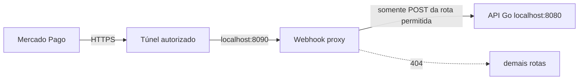

# Proxy restrito do webhook Mercado Pago

O comando `backend/cmd/webhook-proxy` existe apenas para validação externa temporária. Ele encaminha uma única combinação:

```text
POST /api/v1/webhooks/mercado-pago
```

Qualquer outra rota recebe `404`; outro método recebe `405`. O proxy limita o corpo a 64 KiB, aplica limite por IP, remove `Authorization` e `Cookie`, preserva `X-Signature`, `X-Request-Id` e a query `data.id`, e aceita somente uma API upstream em loopback. Corpo, assinatura e credenciais não são registrados.



O HTTPS termina no provedor do túnel. O salto do proxy para a API permanece exclusivamente em loopback. Este projeto não inicia nem configura um túnel automaticamente.

## Validação local antes da exposição

1. Inicie PostgreSQL e a API na porta 8080.
2. Em outro terminal, execute:

   ```powershell
   cd backend
   go run ./cmd/webhook-proxy
   ```

3. Confirme que uma rota privada está bloqueada:

   ```powershell
   curl.exe -i http://127.0.0.1:8090/api/v1/admin/quotes
   ```

   O resultado esperado é `404`.

4. Envie um POST sem assinatura ao caminho permitido. O `401` da API comprova o encaminhamento e a validação HMAC, sem aceitar a notificação:

   ```powershell
   curl.exe -i -X POST "http://127.0.0.1:8090/api/v1/webhooks/mercado-pago?data.id=test" -H "Content-Type: application/json" -d "{}"
   ```

## Validação externa manual

Somente após autorização explícita do responsável:

1. Exponha **a porta 8090**, nunca a porta 8080, por um túnel HTTPS confiável.
2. Cadastre `https://<dominio-do-tunel>/api/v1/webhooks/mercado-pago` nas notificações de teste da aplicação Mercado Pago.
3. Selecione o tópico `order`.
4. Configure no backend o segredo de webhook exibido para esse ambiente e reinicie a API.
5. Dispare uma Order sandbox e acompanhe apenas status e IDs sanitizados.
6. Confirme que a notificação possui `x-signature`, `x-request-id` e `data.id`, recebe HTTP 200 quando aceita, e que a API consulta a Order autenticadamente antes de reconciliar.
7. Reenvie a mesma notificação e confirme deduplicação; envie evento mais antigo e confirme que `provider_updated_at` impede regressão.
8. Tente externamente `/api/v1/health`, `/api/v1/admin/quotes` e `/api/v1/customer/profile`; todos devem retornar `404` pelo proxy.
9. Ao terminar, encerre o túnel e o proxy e remova/inative a URL temporária no painel.

Uma entrega assinada localmente não é evidência de entrega real pela internet. Guarde como evidência externa o horário, status HTTP, tópico, estado anterior/posterior e identificadores truncados, sem assinatura, token, dados do cartão ou dados pessoais.
